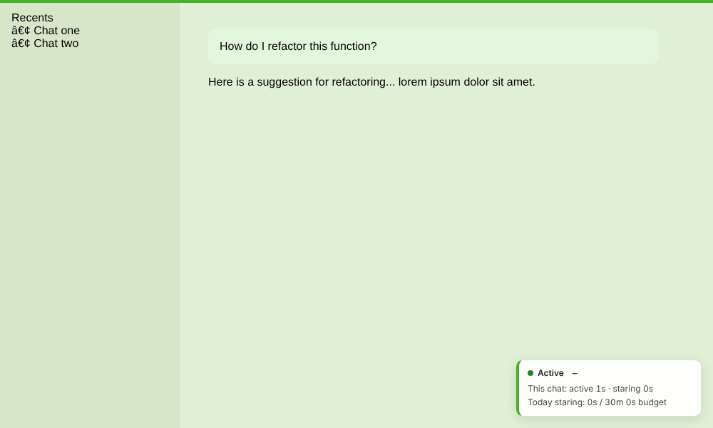
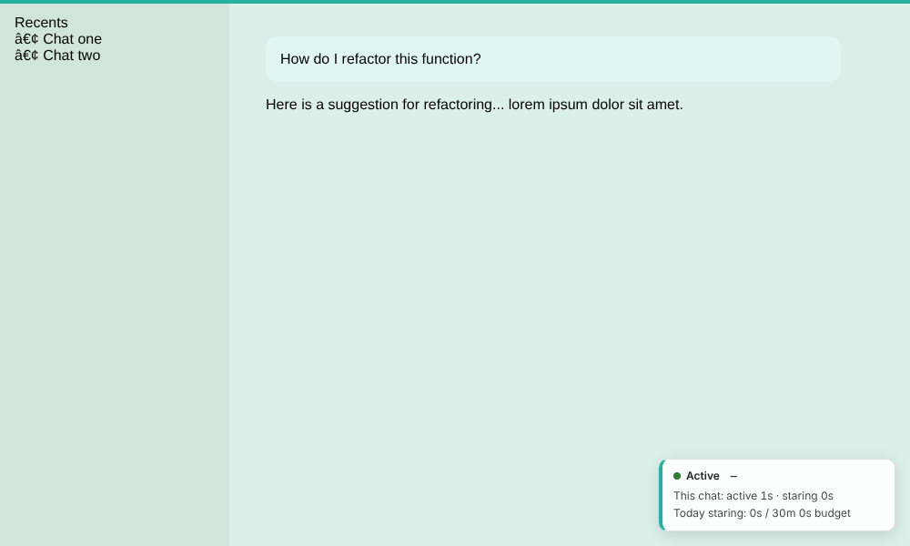
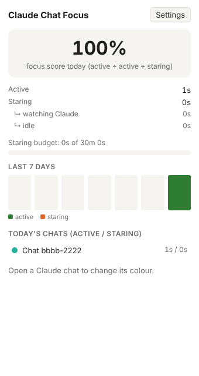
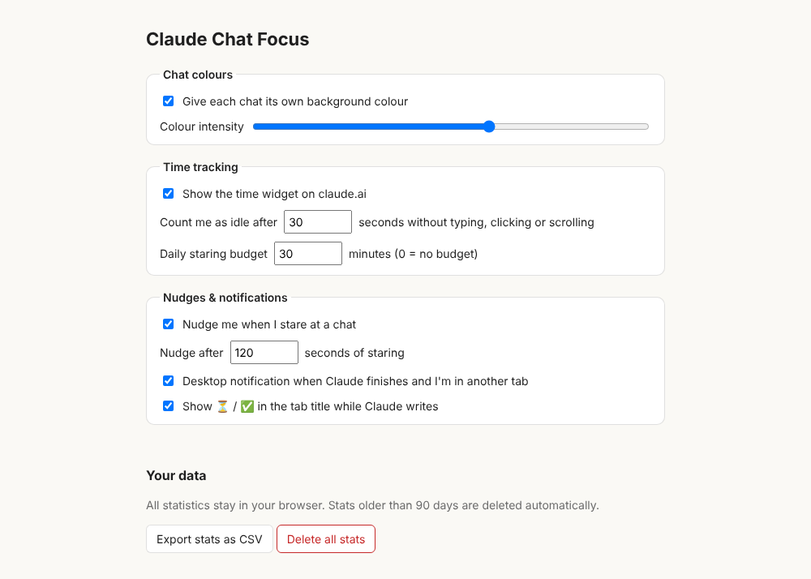

# Claude Chat Focus

A Chrome extension that makes [claude.ai](https://claude.ai) chats easier to tell apart and helps you stop idly staring at them.

| Chat A | Chat B |
| --- | --- |
|  |  |

## Features

**Per-chat colours**
- Each conversation gets its own background tint and a coloured bar along the top, so you can tell which chat you're in at a glance. The colour is derived from the chat id, so it stays the same every time you open that chat.
- Pick a different colour for the current chat from the toolbar popup, or click **Auto** to go back to the generated one.
- Adjust the intensity, or switch colours off, in Settings. Light and dark mode are both supported.

**Time tracking**
- Every second a claude.ai tab is open, it's counted as one of:
  - **Active**: you typed, clicked or scrolled recently.
  - **Watching Claude**: you aren't doing anything and Claude is generating.
  - **Idle**: you aren't doing anything and nothing is happening.
  - **Away**: the tab is in the background or the window isn't focused. This doesn't count against you.
- *Staring* is watching plus idle: time you spent looking at a chat without doing anything.
- A small widget in the corner of claude.ai shows your current state, your staring streak, this chat's active and staring time, and today's staring time against a daily budget. You can collapse it.

**Extras for productivity**
- **Stop-staring nudges**: after 2 minutes of staring (configurable), the widget asks you to take the next step or switch tasks. Further nudges get firmer, and you can snooze them for 10 minutes.
- **"Claude is done" notifications**: switch to other work while Claude writes. When the reply finishes and you're in another tab or app, you get a desktop notification, and clicking it takes you back to the chat.
- **Tab-title status**: ⏳ shows in the tab title while Claude is writing, and ✅ when a reply finished while you were away.
- **Daily staring budget**: the toolbar badge shows today's staring minutes. It's green while you're under budget and red once you go over.
- **Popup dashboard**: a focus score (active ÷ (active + staring)), a breakdown of today's time, a 7-day chart, and today's chats ranked by staring time. Click a chat to open it.
- **Your data**: export everything as CSV. All data stays in `chrome.storage` on your machine, and stats older than 90 days are deleted automatically.

<p>
  
  
</p>

## Install (unpacked)

1. `git clone` this repo (or download the `claude-chat-focus` artifact from a CI run).
2. Open `chrome://extensions` and turn on **Developer mode**.
3. Click **Load unpacked** and select the repo folder, or `dist/claude-chat-focus` after running `npm run package`.
4. Open a chat on claude.ai.

## Development

```sh
npm install
npm test               # unit tests (node:test + jsdom)
npm run test:coverage  # unit tests with a coverage report
npm run test:e2e       # loads the real extension in Chromium against a mock claude.ai
npm run lint
npm run package        # dist/claude-chat-focus/ and dist/claude-chat-focus.zip
node scripts/make-icons.js   # regenerate icons/
```

The extension was built red/green TDD: each module's spec was committed failing before its implementation (see `git log`). The test suite covers:

- **Unit** (`test/unit/`): pure logic (hashing and colours, time classification, nudges, stats aggregation with serialised writes, generation detection, settings validation), plus DOM behaviour in jsdom (widget, theme overlay, popup, options form) and the full content-script controller and service worker against an in-memory `chrome.*` fake (`test/helpers/fake-chrome.js`).
- **Packaging** (`test/unit/manifest.test.js`): every file the manifest and HTML pages reference exists, and classic scripts load after the modules they depend on.
- **End-to-end** (`test/e2e/`): Playwright launches Chromium with the unpacked extension and serves a mock claude.ai through request routing. It checks that colours differ per chat, the overlay doesn't block typing, the title marker appears and clears, stats reach storage through the service worker, live settings and colour changes apply, the options page saves, and a nudge appears after the configured staring time.

### Layout

```
manifest.json
src/lib/          # all logic as UMD modules: classic scripts in Chrome, require()-able in tests
src/content/      # content-script entry (creates the controller)
src/background/   # service-worker entry (importScripts + createBackground)
src/popup/        # toolbar popup
src/options/      # settings page
test/unit/ test/e2e/ test/helpers/
```

### How "generating" is detected

claude.ai marks a streaming message with `data-is-streaming="true"` and shows a **Stop response** button while it writes. The selectors are in `src/lib/generation.js`. If claude.ai changes its markup, update that list.

## Privacy

The extension only runs on `https://claude.ai/*`. It never reads message contents. It stores only chat ids, chat titles and time totals, all locally, and makes no network requests.

## License

MIT
